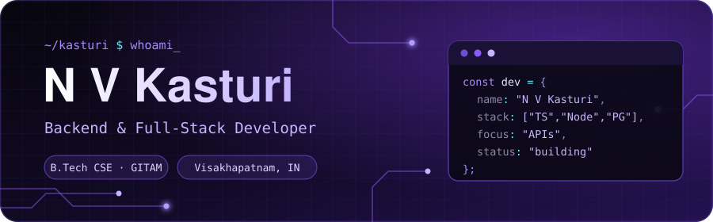
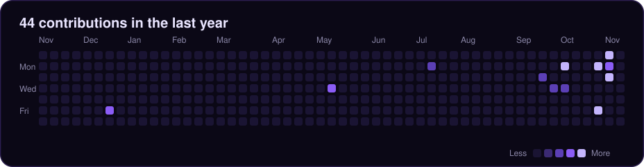

  

  
  
  

## 🔮 About

Hi, I'm Kasturi 👋 I'm a B.Tech CSE (Core) student at **GITAM School of Technology, Visakhapatnam** (CGPA 8.17/10, graduating July 2028). I like building backend-heavy apps and turning messy workflows into clean, secure APIs.

- 💼 **Associate Product Engineering Intern @ Baatasari** (May to Jul 2026)
- 🛡️ Secretary, **GitHub Community GITAM**
- 📣 Social Media Lead, **AeroGitam Club**
- 🌱 Learning DSA, DBMS and system design

## 💼 Experience

**Associate Product Engineering Intern, Baatasari** · May to Jul 2026

- Built the backend for a campus events platform: Google OAuth login, college and club management, event creation, and ticketing/payment flows
- REST APIs in **TypeScript and Express** for auth, admin, ambassador, club and college modules, with **PostgreSQL and Prisma** for data modeling and **Redis** for session and event caching
- Shipped hashed session tokens, role-based approval workflows for ambassadors and clubs, **Zod** input validation and rate limiting; Razorpay ticketing in progress

## ⚡ Projects

| Project | What it does | Stack |
|---|---|---|
| [**KAPS MedTech**](https://github.com/Kasturi25n/kaps-medtech) | Healthcare management system with automated scheduling and RBAC between Doctor and Student roles; prototype deployed within 24 hours at Gitathon | Node.js, PostgreSQL, RBAC |
| [**TripSync**](https://github.com/Kasturi25n/Trip_Sync) | Travel coordination platform with a scalable REST API for authentication and real-time itinerary data; built for the SIH 2025 internal round in 24 hours | Node.js, Express.js, REST APIs |
| [**Fake Social Media Account Detection**](https://github.com/pushpam2404/fake_acc) | Multi-dataset pipeline with feature engineering and an XGBoost classifier, with SHAP for explainability; cleared the SIH 2026 internal round | Python, XGBoost, SHAP |
| [**Streakly**](https://github.com/Kasturi25n/streakly) | Full-stack habit and goal tracker deployed on Vercel | React 19, Express 5, MongoDB Atlas |
| [**Expense Tracker**](https://github.com/Kasturi25n/Expense-tracker) | Expense tracker for Indian users: income, expenses, accounts, budgets and insights | |

## 🛠️ Tech Stack

**Languages** 
      

**Frameworks & Libraries** 
    

**Databases & Backend** 
    

**Tools** 
   

**Core CS:** Data Structures & Algorithms · OOP · DBMS · Memory Management

## 🏆 Achievements

- **Smart India Hackathon:** cleared the 2026 internal round (fake account detection); built TripSync in the 2025 internal round within a 24-hour deadline
- **Gitathon:** deployed the KAPS MedTech prototype within 24 hours
- **HackerRank Certified:** Problem Solving (Basic), Nov 2025

## 📊 Contributions

  

  

  
  

